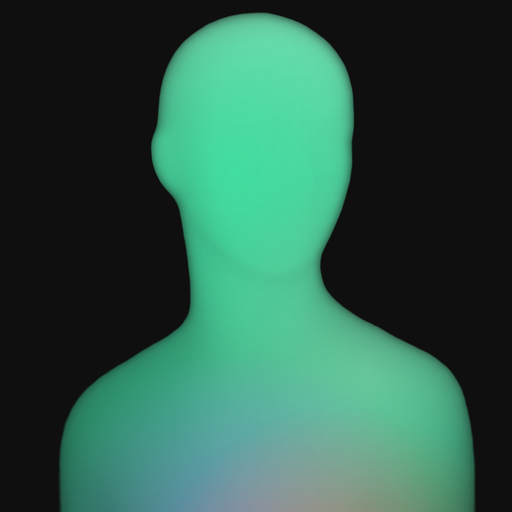

# EvrFit

Review your EvrFit history, log your day and prepare supported meal and workout plans from Claude. This plugin bundles an EvrFit workflow skill and the secure remote EvrFit MCP connector.

## Connect your account

An existing EvrFit account, age 18 or over, and active EvrFit Plus access are required. Install the plugin, open its **Connectors** tab and connect **EvrFit**. Follow the OAuth handoff to your signed-in EvrFit app, choose the access you want to grant and return to the browser where you started. A computer may show a QR code for iPhone approval. Users do not need to create API keys or OAuth clients. On Claude Code, connect the bundled server through the host's MCP authentication controls.

Manage access or disconnect in **EvrFit → Profile → Connected Assistant**. One assistant can be connected at a time; disconnect the current assistant before switching. Disconnecting stops future EvrFit access; it cannot remove information Claude has already received or clear Claude's saved connection label. The plugin needs its own working account connection even when installed. Assistant and EvrFit subscriptions are separate.

## Try it

- “Review my last seven days of nutrition, workouts and water. Explain what is missing.”
- “Log 250 ml of water for me now and show today's entries.”
- “Prepare a workout plan using my EvrFit preferences. Validate it and show me before replacing my current plan.”
- “Show the extracted text from my latest report and say whether extraction is incomplete.”

The skill instructs Claude to check the live connection, retrieve the requested records, use supported foods, exercises and units, and report a save only after EvrFit confirms it. Medicine and report access require the permissions you choose. Plan proposals are validated by EvrFit before replacement. EvrFit's own AI regeneration additionally needs your existing health-AI consent, relevant permissions and allowance.

## Limits and data handling

EvrFit provides fitness and general wellness features, not diagnosis, treatment or prescribing. Missing logs do not establish missed meals, exercise or doses. Nutrition estimates, extracted reports and AI output may be incomplete or inaccurate. Activity history is retained for up to 90 days; reports and profile data have different retention rules. Only retained data that your connection permits is available.

The plugin files contain instructions and connection configuration, not health records or credentials. The connector sends authorized results to Claude, where Anthropic's terms and your account's privacy settings apply. No additional analytics or third-party destination is bundled. Tool calls enforce live account ownership, Plus and approved permissions on EvrFit's servers. HealthKit and reminder updates may await the authorized phone; viewing original report resources depends on the Claude surface.

For a connection problem, check EvrFit Plus and Connected Assistant, then reconnect from this plugin's Connectors tab. Start a fresh connection request if an earlier one expired. Unavailable tools or denied access must be reported as such, not replaced with guessed history.

[Website](https://evrfit.app) · [Support](https://evrfit.app/support) · [Privacy](https://evrfit.app/privacy) · [Terms](https://evrfit.app/terms)

Published by Arqevia Labs Private Limited. Publisher contact: support@arqevialabs.com. For EvrFit product support, use the support link above. The plugin is distributed under the accompanying proprietary license; EvrFit's app, backend, marks and user data are not licensed by this package.
